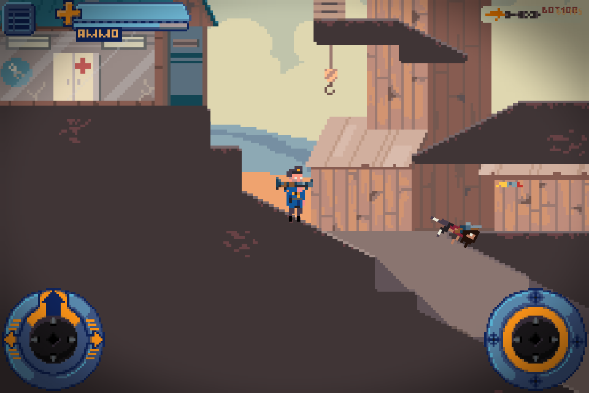
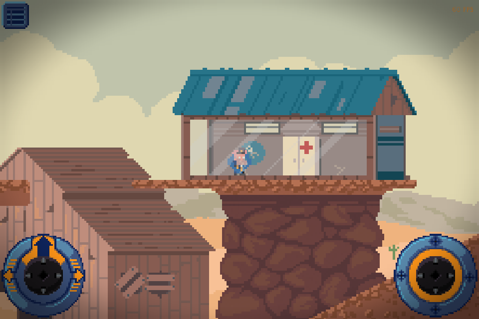
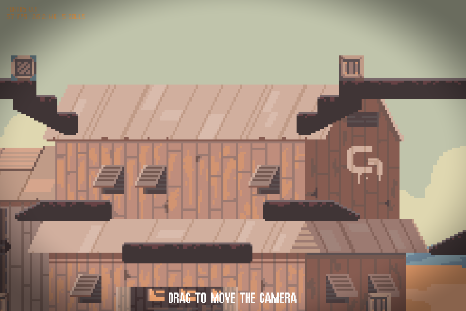
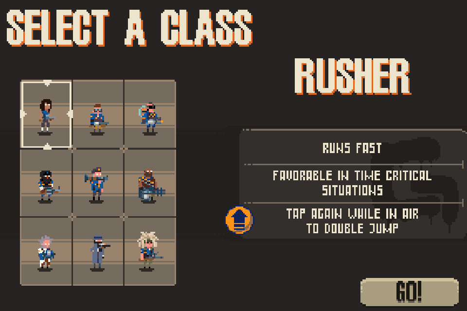
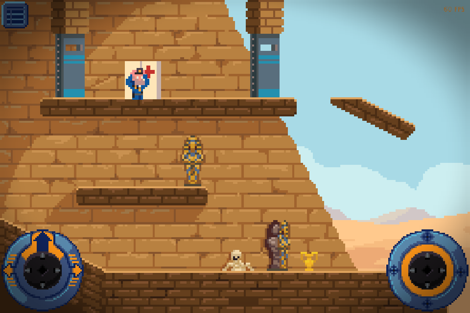

### A demake of GANGFORT for the iPhone 4S on iOS 6

_Native C and OpenGL ES 2.0, offline matches against bots, your own copy of the game_

  <a href="#overview"><b>Overview</b></a> |
  <a href="#you-need-a-copy-of-gangfort"><b>GANGFORT.apk</b></a> |
  <a href="#install"><b>Install</b></a> |
  <a href="#build"><b>Build</b></a> |
  <a href="docs/decisions.md"><b>Decisions</b></a> |
  <a href="TODO.md"><b>Roadmap</b></a>

---

> [!NOTE]
> **Version 0.3.0 is out.** A player walks, jumps, aims, and shoots on the
> three maps of single player with the touch sticks of GANGFORT, at 60
> frames each second on the iPhone 4S. The other classes, the game modes,
> and the bots come in the next versions. [TODO.md](TODO.md) lists them.
> [CHANGELOG.md](CHANGELOG.md) lists the changes of each release.

> [!IMPORTANT]
> This is a fan project. It is not from the makers of GANGFORT. The
> repository and the .deb hold no file of GANGFORT. You need your own copy.

---

<table>
<tr>
<td width="50%" valign="top">

<i>A kill</i>

</td>
<td width="50%" valign="top">

<i>bomb_canyon</i>

</td>
</tr>
<tr>
<td width="50%" valign="top">

<i>The gantown map</i>

</td>
<td width="50%" valign="top">

<i>The nine classes</i>

</td>
</tr>
<tr>
<td width="50%" valign="top">

<i>flag_egypt</i>

</td>
<td width="50%" valign="top">
</td>
</tr>
</table>

## Overview

**FortOS** plays GANGFORT on an iPhone 4S with
iOS 6.1.3. GANGFORT itself does not run on iOS 6. FortOS is a new engine in
C, with the rules of GANGFORT 2.1.

GANGFORT has a single player mode against bots. FortOS ports it: the
local game server, the bots, their paths on each map, the 9 classes, the
weapons, and the 3 game modes. The rules come from the code of the Android
APK of GANGFORT 2.1. FortOS has no network code.

The app reads the art, the maps, the fonts, the text, and the sounds from
the APK of your own copy. It holds no file of GANGFORT.

## You need a copy of GANGFORT

The art, the sounds, the maps, and the text of GANGFORT belong to their
owners. FortOS reads them from the APK of GANGFORT 2.1 for Android.

1. Get the APK of your copy of GANGFORT 2.1.
2. Copy it to `/var/mobile/Media/FortOS/GANGFORT.apk` on the phone, with
   an AFC tool or with `scp`.

On its first start, the app decodes the textures and keeps them in
`/var/mobile/Media/FortOS/cache/`.

## Install

You need an iPhone, iPod touch, or iPad with iOS 6 and a jailbreak.

1. Download the `.deb` file from the
   [latest release](https://github.com/Stiven-Gjekaj/FortOS/releases/latest).
2. Copy it to the phone, for example with `scp` to `/tmp/`.
3. On the phone, as root: `dpkg -i /tmp/io.github.stivengjekaj.fortos_*.deb`.

The FortOS icon comes on the home screen. To remove the app:
`dpkg -r io.github.stivengjekaj.fortos`.

On iOS 7 or later, or with an APT that has TLS 1.2, you can also add the
Cydia source `https://stiven-gjekaj.github.io/cydia/`. Cydia on iOS 6
cannot read it, because its APT stops at TLS 1.0 and GitHub accepts only
TLS 1.2. See [the repository](https://github.com/Stiven-Gjekaj/cydia).

## Build

You need a Mac with Xcode and the iOS 9.3 SDK of Theos.

1. Download `iPhoneOS9.3.sdk.tar.xz` from the releases of
   [theos/sdks](https://github.com/theos/sdks/releases) and unpack it into
   `sdks/`. The result is `sdks/iPhoneOS9.3.sdk`. Git does not track `sdks/`.
2. Run `./fix-sdk.sh` one time. It changes the SDK stubs for the new Apple
   linker and for iOS 6.
3. Build:

| Command | Result |
| ------- | ------ |
| `scripts/app.sh` | `build/FortOS.app` |
| `scripts/deb.sh` | The Cydia package in `build/` |
| `scripts/test.sh` | The tests, on the Mac |
| `scripts/test.sh --phone` | The tests, on the phone |
| `scripts/install.sh` | Builds the app, copies it to the phone, and opens it |
| `scripts/install.sh --debug` | The same, with the debug commands of `src/game/fo_debug.c` |
| `scripts/tap.sh` | Sends debug commands, as `"tap X Y"`, to a debug build |
| `scripts/shot.sh` | Saves a screenshot of the phone |
| `scripts/release.sh` | Tests, packs, tags, and publishes a release |
| `python3 tools/logo.py` | The logo and the icons of the app |

The phone scripts use `ssh iphone4s`. Set up that host in `~/.ssh/config`,
for example with a USB tunnel of `iproxy` on port 2222. `scripts/install.sh`
copies the APK in `reference/` to the phone, or the APK in `GANGFORT_APK`.

`build.sh` builds one armv7 binary. It compiles with ARC and links without
ARC, and all code is in ARM mode (`-marm`). The new Apple linker makes Thumb
code that crashes on iOS 6 before `main` starts.

## Support

If you find FortOS useful, you can support its development here.

## Licence

The code is under the MIT licence. See [LICENSE](LICENSE). GANGFORT and its
art, sounds, maps, and text belong to their owners.
